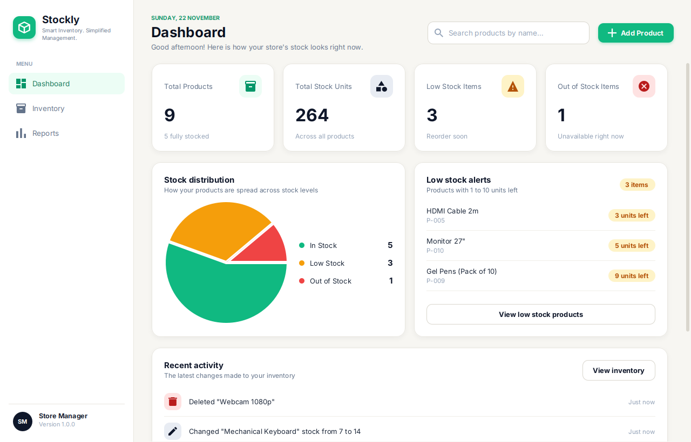
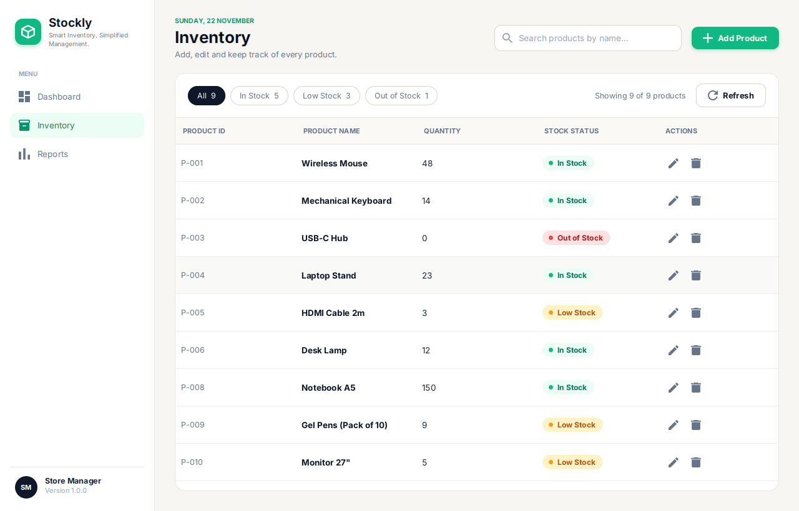

# Stockly - Smart Inventory. Simplified Management.

A modern JavaFX desktop application for managing the stock of a small retail store.
Built for the Software Construction Open-Ended Lab (OEL).

**Author:** Umama Wahab

| Dashboard | Inventory |
|---|---|
|  |  |

## Features

- **Dashboard** - Total Products, Total Stock Units, Low Stock and Out of Stock cards, a stock-distribution pie chart, low-stock alerts, recent activity and a friendly empty state. Everything is calculated live from the inventory.
- **Inventory** - TableView with Product ID, Name, Quantity, Stock Status and Actions; add, edit, delete, search by name, filter by status, refresh, sortable columns, empty states.
- **Add / Edit dialog** - modal dialog with inline validation messages and a live preview of the stock status.
- **Reports** - totals, in-stock / low-stock / out-of-stock counts with percentages and a stacked bar.
- **Automatic stock status** - 0 = Out of Stock, 1-10 = Low Stock, more than 10 = In Stock. It can never be typed in, so it can never be inconsistent.
- **Persistence** - data is saved to a JSON file after every change and loaded at start-up.
- Keyboard shortcuts: `Ctrl+N` add product, `Ctrl+F` focus search (`Cmd` on macOS).

## Requirements

- JDK 21 (or newer LTS)
- Maven 3.9+
- Internet access the first time, so Maven can download JavaFX (no other libraries are used at runtime).

## Run

```bash
mvn clean javafx:run
```

## Run the unit tests

```bash
mvn test
```

## Build a runnable JAR

```bash
mvn clean package
java -jar target/stockly-1.0.0-all.jar
```

The "fat jar" contains the JavaFX libraries for the operating system it was built on, so build it on the OS you will demonstrate on.

## Generate the Javadoc

```bash
mvn javadoc:javadoc
```

The HTML documentation is written to `docs/javadoc/`. Open **`docs/javadoc/index.html`** by double-clicking it (it opens in your browser).
A pre-generated copy is already included in this project.

Without Maven (plain JDK, adjust the JavaFX path):

```bash
javadoc -d docs/javadoc -sourcepath src/main/java -subpackages com.stockly -author \
  --module-path /path/to/javafx-sdk/lib --add-modules javafx.controls,javafx.fxml
```

## Where is my data?

`<your home folder>/.stockly/inventory.json` - a plain text file you can open in any editor.
To use another location run with `-Dstockly.data=/some/path/inventory.json`, for example
`mvn javafx:run -Djavafx.args="-Dstockly.data=/tmp/demo.json"` or `java -Dstockly.data=... -jar ...`.
Delete the file to start with an empty inventory.

## Project structure

```
stockly/
├── pom.xml
├── README.md
├── .gitignore
├── docs/
│   ├── ARCHITECTURE.md      design decisions and class overview (for the viva)
│   ├── TEST_CASES.md        test-case table to fill in
│   ├── GIT_GUIDE.md         exact Git/GitHub commands and suggested commits
│   ├── REPORT_GUIDE.md      how to prepare the lab report and viva
│   ├── screenshots/
│   └── javadoc/             generated HTML documentation (open index.html)
└── src/
    ├── main/java/com/stockly/
    │   ├── Main.java                    entry point
    │   ├── InventoryApplication.java    JavaFX Application, wires everything together
    │   ├── AppInfo.java
    │   ├── model/        Product, StockStatus, Activity, ActivityType
    │   ├── service/      InventoryManager (business logic), exceptions, repository interface
    │   ├── persistence/  JsonInventoryRepository, SimpleJson
    │   ├── controller/   MainController, DashboardController, InventoryController,
    │   │                 ReportsController, ProductDialogController, AppShell, Page
    │   └── ui/           Icon, StatusBadge, EmptyState, ConfirmDialog, Resources, TimeFormat, ToastType
    ├── main/resources/com/stockly/
    │   ├── css/stockly.css
    │   └── view/         MainView, DashboardView, InventoryView, ReportsView, ProductDialog (.fxml)
    └── test/java/com/stockly/   JUnit 5 tests
```

The `.fxml` files open in **Scene Builder** for visual editing of the layout (Scene Builder may warn that it cannot instantiate the controller; the layout still opens, because controllers receive their dependencies through the constructor).
The Settings page from the specification was optional and is not included, so there are no buttons that only look functional.
